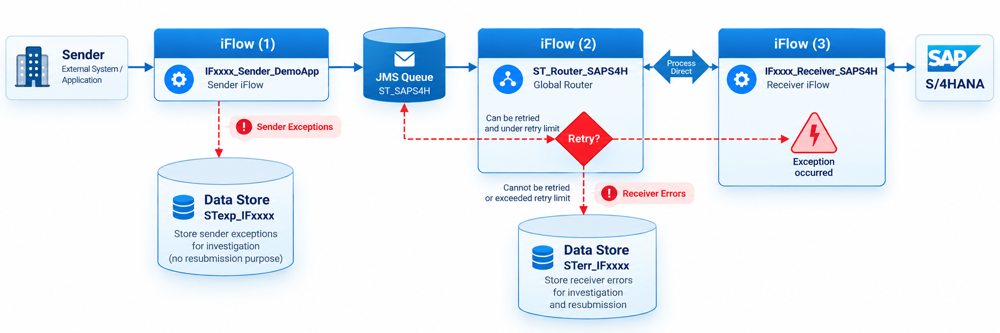
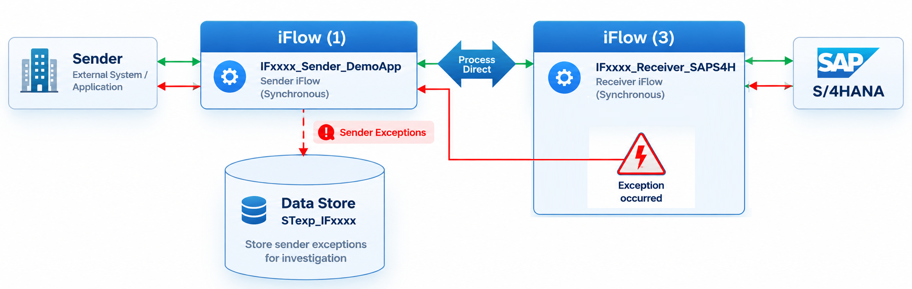

# ST Integration Framework
**Standardized by Design. Reliable by Default.**

ST Integration Framework is an open-source collection of reusable SAP Cloud Integration integration flows and Groovy utilities developed and maintained by **ST Consultancy B.V.** It provides reusable patterns for consistent message processing, routing, exception handling, and integration operations.

The framework is distributed as an **import-ready SAP Cloud Integration package**. Its iFlows and embedded Groovy scripts are included in the package ZIP and can be inspected and adapted in SAP Cloud Integration. The repository does not maintain separate copies of these artifacts.

## Capabilities
- **Standardized processing:** Patterns for synchronous ProcessDirect and asynchronous JMS-based integrations.
- **Reusable routing:** Shared router iFlows for dispatching messages to interface-specific receiver flows.
- **Sender exception handling:** Standardized diagnostics and recovery approaches for HTTP and IDoc senders.
- **Receiver error handling:** Error classification, configurable retries, failed-message persistence, and recovery.
- **Notification/event collection:** Patterns for collecting and consolidating business-object change notifications.
- **Reusable scripts:** Groovy utilities packaged with the integration artifacts.

Actual configuration and supported behavior depend on the included artifacts and the connected systems.

## Architecture
A typical asynchronous integration follows this pattern:

For synchronous interfaces, sender and receiver iFlows communicate directly through ProcessDirect.

## Download
Download the latest release of ST Integration Framework: [**Download Latest Release**](https://github.com/st-consultancy/st-integration-framework/releases/latest)

The release includes import-ready SAP Cloud Integration packages:
- ST | Integration Accelerators
- PI0000 | HttpClient | Customer (Getting Started)

See the documentation for installation and configuration.

> **Note:** The downloadable ZIP is the authoritative distribution of the iFlows and Groovy scripts. There is no separate `scripts/` or `src/` directory in this repository. Release availability and contents are documented on the Releases page.

## Documentation
- [Naming Convention](docs/Naming_Convention.md)
- [Sender Exception Handling](docs/Sender_Exception_Handling.md)
- [Receiver Error Handling](docs/Receiver_Error_Handling.md)
- [Notification Event Collector](docs/Notification_Event_Collector.md)

## ST Integration Toolkit
The **ST Integration Toolkit** is a separate commercial offering developed by ST Consultancy B.V. that complements the open-source ST Integration Framework with advanced operational, testing, and AI-powered troubleshooting capabilities.

The Toolkit includes:
- **Error Handling App:** Investigate, correct, retry, and resubmit failed messages.
- **Audit Logging App:** Track error-handling activities, message recovery operations, and payload changes for traceability and auditing.
- **iFlow Testing App:** Execute integration tests, validate message transformations, and compare actual results against expected results.
- **AI Log Analyzer App:** Analyze sender exceptions and receiver errors using AI, identify potential root causes, and recommend corrective actions.

The Toolkit helps integration teams reduce troubleshooting effort, improve operational efficiency, and maintain greater visibility and control over their SAP Cloud Integration landscape.

**Note:** ST Integration Toolkit is a proprietary commercial product and is not included in the Apache License 2.0 distribution of ST Integration Framework.

## License
Licensed under the [Apache License, Version 2.0](LICENSE). See [NOTICE](NOTICE) for project attribution and notices.

Copyright 2026 ST Consultancy B.V.

## Feedback and maintenance
ST Integration Framework is developed and maintained by ST Consultancy B.V. Bug reports and feature suggestions are welcome through GitHub Issues. External code contributions and pull requests are not currently accepted.

## Disclaimer
This is an independent project and is not an official SAP product or endorsed by SAP SE. SAP product names and trademarks belong to their respective owners. The software is provided **AS IS**, without warranties or conditions of any kind, as described in the Apache License 2.0.

## About ST Consultancy B.V.
ST Consultancy B.V. specializes in SAP Integration and SAP Business Technology Platform (BTP), including SAP Cloud Integration, API Management, Event Mesh, and BTP application development.
- **Website:** https://st-consultancy.com
- **Email:** info@st-consultancy.com
- **LinkedIn:** https://linkedin.com/company/st-consultancy88