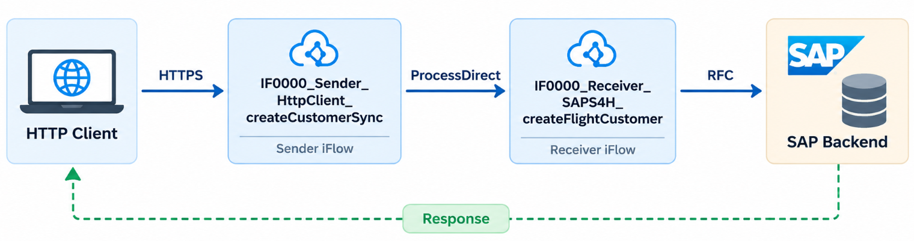
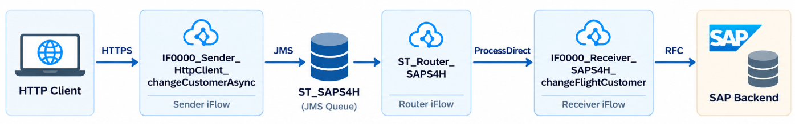

# Getting Started with ST Integration Framework

## 1. Overview
The **PI0000 | HttpClient | Customer** package provides practical examples of building integrations using the ST Integration Framework on SAP Cloud Integration.

**Standardized by Design. Reliable by Default.**

The package demonstrates two common integration patterns:
- **Synchronous Customer Creation:** An HTTP client sends a request to create a Flight Customer in SAP and receives the processing result immediately.
- **Asynchronous Customer Update:** An HTTP client submits a customer change request, which is processed asynchronously using JMS and reusable routing components.

Both scenarios demonstrate the separation of sender and receiver responsibilities, standardized exception handling, and reusable framework components.

The examples use SAP Flight Customer RFC function modules to keep the business logic simple and focus on integration design.

## 2. Integration Architecture

### Scenario 1: Synchronous Customer Creation

The synchronous scenario demonstrates how to separate inbound communication from backend processing while maintaining a single request-response interaction.

**Key features demonstrated:**
- HTTPS sender adapter
- Synchronous ProcessDirect communication
- Separation of sender and receiver iFlows
- RFC receiver adapter
- Standardized sender exception handling
- Synchronous response propagation

### Scenario 2: Asynchronous Customer Update

The asynchronous scenario decouples message reception from backend processing.

Once a message is successfully handed over to JMS, the sender can acknowledge the request without waiting for SAP backend processing to complete.

**Key features demonstrated:**
- HTTPS-to-JMS asynchronous integration
- Reliable message buffering
- Reusable global message routing
- Dynamic receiver dispatching using `st_mainFlow`
- Separation of sender and receiver processing
- Standardized receiver error handling
- Automatic retry and failed-message persistence
- Manual message recovery

## 3. Integration Flow Reference

### IF0000_Sender_HttpClient_createCustomerSync
**Purpose:** Receive synchronous customer creation requests.

This iFlow exposes an HTTPS endpoint to external applications.

It forwards the request to the receiver iFlow using ProcessDirect and waits for the processing result.

If an exception occurs during processing, standardized sender exception handling captures the error information and prepares the HTTP error response.

**Demonstrates:**
- HTTPS request-response processing
- ProcessDirect communication
- Sender-side exception handling
- Separation of communication and business processing

### IF0000_Receiver_SAPS4H_createFlightCustomer
**Purpose:** Create a Flight Customer in SAP using RFC.

The receiver iFlow accepts requests through ProcessDirect, prepares the backend request, and invokes the SAP Flight Customer RFC function module.

The processing result is returned to the sender iFlow.

Technical exceptions propagate back to the sender, allowing the synchronous request to be handled consistently.

**Demonstrates:**
- Reusable receiver iFlow design
- SAP RFC integration
- Backend request and response handling
- Exception propagation in synchronous processing

### IF0000_Sender_HttpClient_changeCustomerAsync
**Purpose:** Accept asynchronous customer update requests.

The sender iFlow receives an HTTPS request and prepares the message for asynchronous processing.

It sets the framework routing information, including `st_mainFlow`, and publishes the message to the `ST_Incoming` JMS queue.

After successful JMS handover, the HTTP request can complete independently of backend processing.

**Demonstrates:**
- Asynchronous message acceptance
- JMS-based decoupling
- Dynamic routing configuration
- Standardized sender exception handling
- Separation of message reception and processing

### IF0000_Receiver_SAPS4H_changeFlightCustomer
**Purpose:** Update an existing Flight Customer in SAP.

The receiver iFlow is invoked by the global router through ProcessDirect.

It calls the SAP backend using RFC and handles the processing result.

Unlike synchronous processing, backend failures do not need to be returned to the original HTTP client. Instead, the framework can apply its standardized receiver error-handling mechanisms.

**Demonstrates:**
- Asynchronous receiver processing
- SAP RFC integration
- Standardized receiver error handling
- Configurable automatic retry
- Error Data Store persistence
- Failed-message recovery

## 4. Understanding Error Handling
One of the key design principles of ST Integration Framework is the distinction between **sender exceptions** and **receiver errors**.

|                        | Sender exception                                    | Receiver error                             |
|------------------------|-----------------------------------------------------|--------------------------------------------|
| Occurs during          | Message reception or synchronous request processing | Asynchronous backend processing            |
| Primary responsibility | Inform the sender and support investigation         | Support retry, investigation, and recovery |
| Data Store prefix      | `STexp_`                                            | `STerr_`                                   |
| Automatic retry        | Not the primary mechanism                           | Supported where configured                 |
| Message recovery       | Investigation-focused                               | Supports reprocessing                      |

### Sender Exception Handling
Sender exceptions occur when a request cannot be processed successfully during its initial communication flow.

The framework captures relevant error details and can persist exception information in a Data Store using the `STexp_` prefix.

These entries are intended primarily for troubleshooting and investigation.

### Receiver Error Handling
Receiver errors occur when an asynchronous message cannot be processed successfully by the target system.

Depending on the configuration and error type, the framework can retry processing automatically.

Messages requiring investigation or manual recovery can be stored in the Error Data Store using the `STerr_` prefix.

## 5. Failed-Message Recovery
The accelerator package provides a reusable recovery iFlow:

**`ST_Retry_FailedMessage`**
This iFlow allows developers or operators to reprocess a previously failed message without requiring the commercial ST Integration Toolkit.

The recovery process is:
1. Identify the failed message in the Error Data Store.
2. Configure `st_errorDataStoreName` and `st_errorDataStoreEntryID`.
3. Execute `ST_Retry_FailedMessage`.
4. The iFlow retrieves the stored message and republishes it to `ST_Incoming`.
5. `ST_Router_Incoming` dispatches the message to the appropriate receiver using `st_mainFlow`.

Successful republication to JMS does not necessarily mean that backend processing has completed successfully.

## 6. Prerequisites
Before deploying the examples, ensure the following are available:
- SAP Integration Suite — Cloud Integration
- ST Integration Accelerators package
- Required JMS messaging capabilities and queues
- An SAP ABAP backend supporting the Flight Customer RFC function modules
- RFC connectivity to the SAP backend, typically through SAP Cloud Connector
- An HTTP client, such as Postman, for sending test requests

**Note:** Flight Customer RFC function modules are part of SAP's classic Flight Model examples and may not be available in every SAP backend system.

## 7. Installation and Configuration
1. Download the latest release from [GitHub Releases](https://github.com/st-consultancy/st-integration-framework/releases).
2. Import the **ST | Integration Accelerators** package into SAP Cloud Integration.
3. Import the **PI0000 | HttpClient | Customer** package.
4. Configure the required JMS queue and routing settings.
5. Configure the RFC destination and SAP backend connectivity.
6. Configure the HTTPS sender endpoints and required authentication.
7. Deploy the required global router and sample integration flows.
8. Send test requests using an HTTP client.

Refer to the individual iFlow configurations for the required endpoint addresses, payload formats, and externalized parameters.

## 8. Recommended Test Scenarios
| Test                             | Expected behavior                                              |
|----------------------------------|----------------------------------------------------------------|
| Create a customer synchronously  | SAP creates the Flight Customer and returns a response         |
| Trigger a synchronous RFC error  | Sender exception handling prepares an error response           |
| Update a customer asynchronously | Sender accepts the message and hands it over to JMS            |
| Inspect asynchronous routing     | Global router dispatches the message to the receiver iFlow     |
| Trigger a receiver error         | Framework applies configured retry and error-handling behavior |
| Reprocess a failed message       | Recovery iFlow republishes the stored message to JMS           |

## 9. Next Steps
After completing these examples, developers can apply the same integration patterns to their own interfaces.

The framework's reusable components help standardize routing, error handling, retry, and message recovery while keeping interface-specific business logic in dedicated integration flows.

For documentation, bug reports, questions, or suggestions, visit: **[ST Integration Framework on GitHub](https://github.com/st-consultancy/st-integration-framework)**

Developed and maintained by **ST Consultancy B.V.**  
Licensed under **Apache License 2.0**.