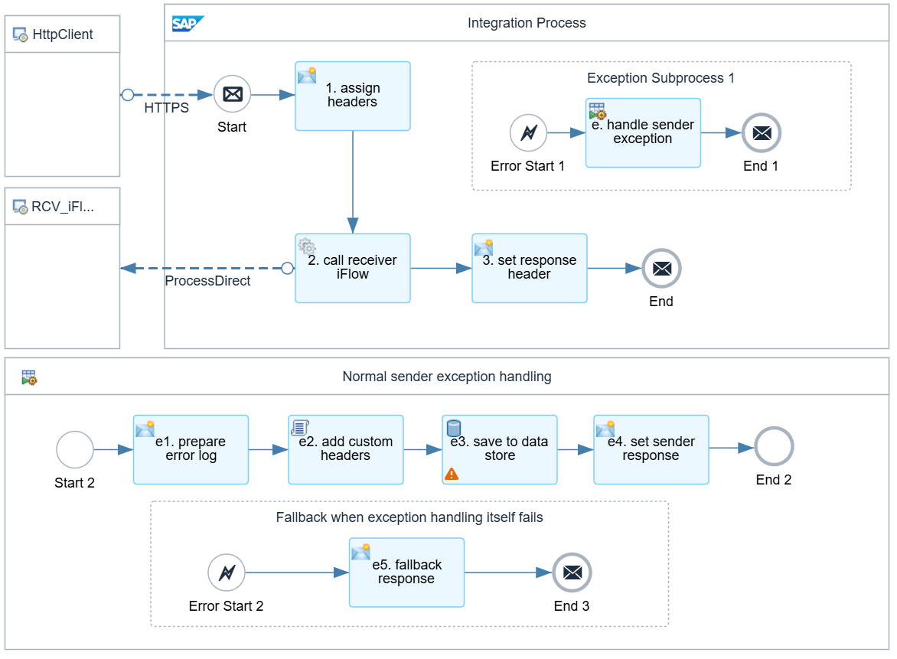
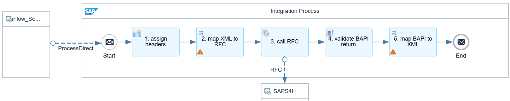
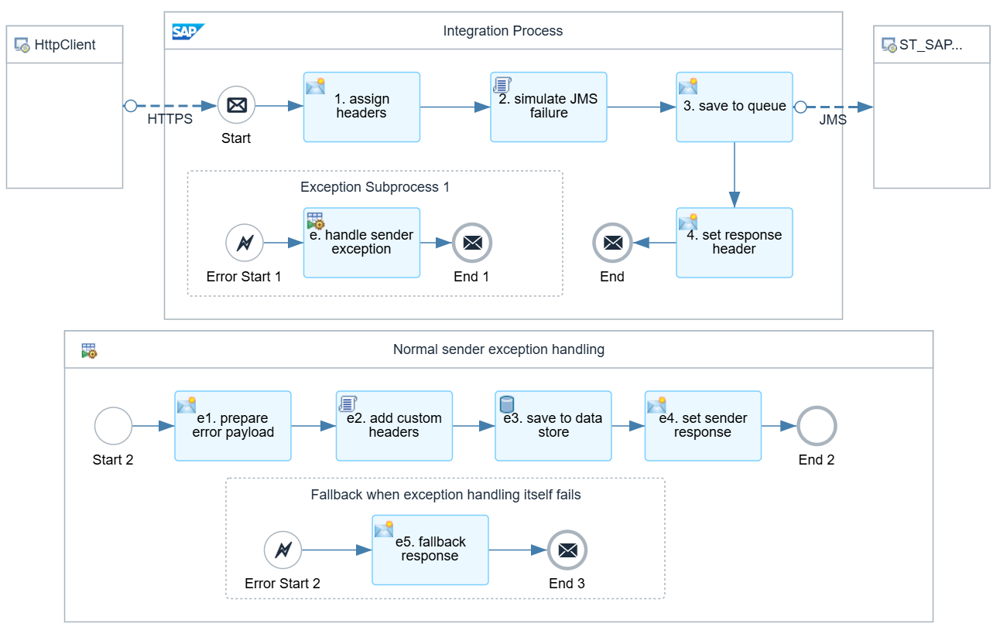
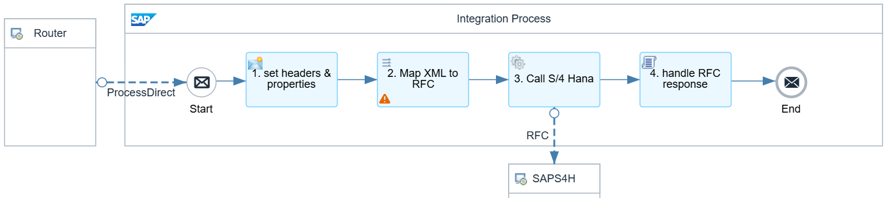
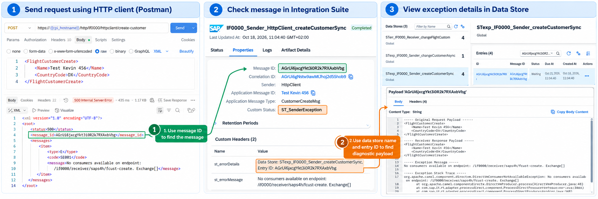
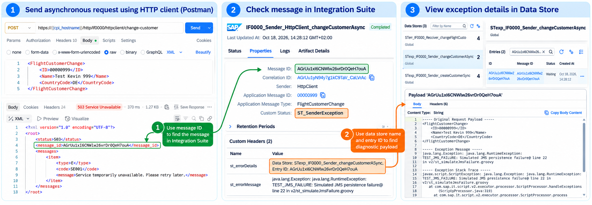
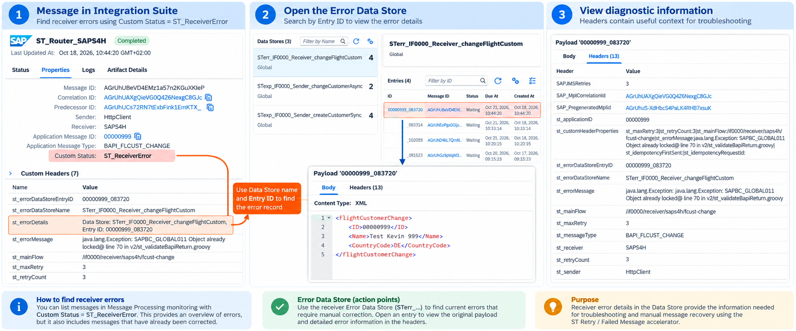

# Getting Started with ST Integration Framework
## Contents

- [Overview](#1-overview)
- [Integration Architecture](#2-integration-architecture)
- [Integration Flow Reference](#3-integration-flow-reference)
- [Understanding Error Handling](#4-understanding-error-handling)
- [Prerequisites](#5-prerequisites)
- [Installation and Configuration](#6-installation-and-configuration)
- [Recommended Test Scenarios](#7-recommended-test-scenarios)
- [Next Steps](#8-next-steps)

## 1. Overview
The **PI0000 | HttpClient | Customer** package provides practical examples of building integrations using the ST Integration Framework on SAP Cloud Integration.

The package demonstrates two common integration patterns:

- **Synchronous Customer Creation:** An HTTP client sends a request to create a Flight Customer in SAP and receives the processing result immediately.

- **Asynchronous Customer Update:** An HTTP client submits a customer change request, which is processed asynchronously using JMS and reusable routing components.

Both scenarios demonstrate the separation of sender and receiver responsibilities, standardized exception handling, and reusable framework components.

The examples use SAP Flight Customer RFC function modules to keep the business logic simple and focus on integration design. Availability of these sample modules depends on the connected ABAP system.

## 2. Integration Architecture
### Scenario 1: Synchronous Customer Creation


The synchronous scenario demonstrates how to separate inbound communication from backend processing while maintaining a single request-response interaction.

### Scenario 2: Asynchronous Customer Update


The asynchronous scenario decouples message reception from backend processing.

Once a message is successfully handed over to JMS, the sender can acknowledge the request without waiting for SAP backend processing to complete.

## 3. Integration Flow Reference
### IF0000_Sender_HttpClient_createCustomerSync
**Purpose:** Receives synchronous customer creation requests via HTTPS and forwards them to the receiver iFlow using ProcessDirect.



**Processing Steps**

1. **Assign Headers:** Initializes the framework headers and properties required for message processing.

2. **Call Receiver iFlow:** Invokes `IF0000_Receiver_SAPS4H_createFlightCustomer` synchronously using ProcessDirect.

3. **Set Response Header:** Prepares the HTTP response headers before returning the processing result to the client.

**Standardized Sender Exception Handling**

If an exception occurs, the iFlow invokes the reusable sender exception-handling process, which performs the following steps:

- **e1. Prepare Error Log:** Sets the target exception data store `st_exceptionDataStore` and collects exception details for troubleshooting.

- **e2. Add Custom Headers:** Adds relevant metadata for monitoring and investigation.

- **e3. Save to Data Store:** Persists exception details in the sender exception Data Store (`STexp\_...`).

- **e4. Set Sender Response:** Prepares an appropriate error response for the HTTP client.

The exception-handling process also includes a **fallback mechanism (e5)** to return an error response if the exception handler itself fails.

### IF0000_Receiver_SAPS4H_createFlightCustomer
**Purpose:** Creates a Flight Customer in SAP using RFC and returns the processing result to the sender iFlow synchronously.



**Processing Steps**

1. **Assign Headers:** Initializes the required headers for message processing.

2. **Map XML to RFC:** Transforms the incoming customer XML into the request structure expected by the SAP RFC function module.

3. **Call RFC:** Invokes the SAP backend through the RFC receiver adapter to create the Flight Customer.

4. **Validate BAPI Return:** Evaluates the BAPI return messages to identify functional errors that may not trigger an RFC adapter exception.

5. **Map BAPI to XML:** Transforms the SAP response into the XML format returned to the sender iFlow.

**Error Handling**

The receiver iFlow distinguishes between technical exceptions and functional errors:

- **Technical exceptions:** RFC connectivity failures, timeouts, or other runtime exceptions propagate to the synchronous sender iFlow.

- **Functional errors:** The BAPI return validation step checks for application-level errors and can raise an exception when customer creation fails.

In both cases, the sender iFlow handles the propagated exception through the framework's standardized sender exception-handling process.

### IF0000_Sender_HttpClient_changeCustomerAsync
**Purpose:** Receives asynchronous customer update requests via HTTPS and publishes them to the `ST_SAPS4H` JMS queue for processing by the receiver iFlow.



**Processing Steps**

1. **Assign Headers:** Initializes the framework headers and properties, including `st_mainFlow`, which identifies the receiver iFlow to be invoked by the global router.

2. **Simulate JMS Failure:** Provides a testing mechanism to simulate a JMS failure and demonstrate standardized sender exception handling.

3. **Save to Queue:** Publishes the customer update message to the `ST_SAPS4H` JMS queue for asynchronous processing.

4. **Set Response Header:** Prepares the HTTP response headers to acknowledge successful message submission.

**Standardized Sender Exception Handling**

If an exception occurs during message reception or JMS publishing, the iFlow invokes the reusable sender exception-handling process:

- **e1. Prepare Error Payload:** Sets the target exception data store `st_exceptionDataStore`, collects exception details and prepares the error payload.

- **e2. Add Custom Headers:** Adds relevant metadata for monitoring and troubleshooting.

- **e3. Save to Data Store:** Persists exception details in the sender exception Data Store (`STexp\_...`) for investigation.

- **e4. Set Sender Response:** Prepares an appropriate HTTP error response.

The exception-handling process also includes a **fallback mechanism (e5)** to return an error response if the exception handler itself fails.

**Important:** A successful HTTP response confirms that the message has been handed over to JMS. It does not indicate that the customer update has been completed successfully in SAP. Backend processing and receiver error handling are performed independently by `ST_Router_SAPS4H` and the receiver iFlow.

### IF0000_Receiver_SAPS4H_changeFlightCustomer
**Purpose:** Processes asynchronous customer update requests received from `ST_Router_SAPS4H` via ProcessDirect and updates Flight Customer data in SAP using RFC.



**Processing Steps**

1. **Set Headers & Properties:** Initializes the framework headers and properties required for message processing and error handling.

2. **Map XML to RFC:** Transforms the incoming customer XML into the request structure expected by the SAP RFC function module.

3. **Call S/4HANA:** Invokes the SAP backend through the RFC receiver adapter to update the Flight Customer.

4. **Handle RFC Response:** Evaluates the RFC response and handles application-level errors that may not trigger a technical exception.

**Standardized Receiver Error Handling**

Unlike the synchronous scenario, asynchronous processing does not return backend errors directly to the original HTTP client. Instead, the framework handles processing failures through the reusable `ST_Router_SAPS4H` integration flow.

Depending on the error type and framework configuration:

- **Automatic Retry:** Transient errors can trigger configurable retry processing.

- **Error Persistence:** Failed messages can be stored in the receiver Error Data Store (`STerr\_...`) for investigation and recovery.

- **Manual Recovery:** Failed messages can be reprocessed using the `ST_Retry_FailedMessage` iFlow.

This separation allows receiver iFlows to focus on backend communication and business processing while the framework provides standardized error handling.

**Important:** The receiver iFlow does not implement its own JMS retry mechanism. Retry and error persistence are managed by the reusable routing framework, allowing consistent error handling across multiple receiver iFlows.

## 4. Understanding Error Handling
One of the key design principles of ST Integration Framework is the distinction between **sender exceptions** and **receiver errors**.

\|                        | Sender exception                                    | Receiver error                             |

\|------------------------|-----------------------------------------------------|--------------------------------------------|

\| Occurs during          | Message reception or synchronous request processing | Asynchronous backend processing            |

\| Primary responsibility | Inform the sender and support investigation         | Support retry, investigation, and recovery |

\| Data Store prefix      | `STexp\_`                                            | `STerr\_`                                   |

\| Automatic retry        | Not the primary mechanism                           | Supported where configured                 |

\| Message recovery       | Investigation-focused                               | Supports reprocessing                      |

### Sender Exception Handling
Sender exceptions occur when a request cannot be processed successfully during synchronous processing or asynchronous message submission.

The ST Integration Framework provides standardized exception handling to capture error details, return a meaningful HTTP response, and persist diagnostic information in an Exception Data Store (`STexp\_...`) for troubleshooting.

The following examples demonstrate sender exception handling in both synchronous and asynchronous integrations.

#### Example 1: Synchronous Customer Creation
In `IF0000_Sender_HttpClient_createCustomerSync`, an exception is triggered when the ProcessDirect receiver endpoint is unavailable.



#### Example 2: Asynchronous Customer Update
In `IF0000_Sender_HttpClient_changeCustomerAsync`, a simulated JMS persistence failure demonstrates how the framework handles exceptions during asynchronous message submission.



#### How to Investigate a Sender Exception
Both examples follow the same troubleshooting process:

1. **Check the HTTP response:** The framework returns an appropriate HTTP error code (such as `500` or `503`), an error message, and a `message_id`.

2. **Find the message in Integration Suite:** Search for the `message_id` in Message Processing monitoring. The message may show **Completed**, with the custom status `ST_SenderException`, because the exception was handled by the framework.

3. **Locate the Exception Data Store:** Open the message properties and find the `st_errorDetails` custom header, which identifies the Data Store name and Entry ID.

4. **Inspect the diagnostic payload:** Open the corresponding Data Store entry to examine the original request payload, available response payload, exception message, and stack trace.

The `st_errorMessage` custom header also provides a quick summary of the exception directly in Message Processing monitoring.

**Important:** A message with processing status **Completed** does not necessarily indicate successful business processing. Always check the custom status and error details.

Exception Data Store entries (`STexp\_...`) are intended primarily for **investigation and troubleshooting**, not automatic message reprocessing. Receiver errors requiring retry or recovery are handled separately through the framework's receiver error-handling mechanism.

### Receiver Error Handling
Receiver errors occur when an asynchronous message cannot be processed successfully by the target system.

The ST Integration Framework provides standardized receiver error handling, including configurable automatic retries, error persistence, and manual message recovery.

When automatic retries are exhausted, or an error requires manual intervention, the failed message is stored in a **Receiver Error Data Store (`STerr\_...`)** for investigation and reprocessing.



#### Investigating Receiver Errors
There are two ways to investigate receiver errors in SAP Cloud Integration:

**1. Error Data Store — Outstanding Action Points (Recommended)**

The Receiver Error Data Stores (`STerr\_...`) provide a list of failed messages requiring attention.

Each entry contains:

- **Original Message Payload:** The failed business message, which can be inspected and corrected if necessary.

- **Error Details:** The exception message describing the processing failure.

- **Message Context:** Headers containing sender, receiver, message type, application ID, and routing information.

- **Retry Information:** Headers such as `st_retryCount` and `st_maxRetry`, indicating how many retries have been attempted.

- **Recovery Information:** The Data Store name, Entry ID, and `st_mainFlow` required for message reprocessing.

These entries serve as **action points** for support teams. Treat these entries as an operational worklist. The recovery iFlow removes the original entry after successful JMS submission; verify downstream processing separately, because JMS acceptance is not proof of backend success.

**2. Message Monitoring — Historical Error Logs**

Receiver errors can also be identified in **Message Processing Monitoring** by filtering on: `Custom Status = ST_ReceiverError`

The monitoring records provide additional information, including message IDs, correlation IDs, error messages, and references to the Error Data Store.

However, Message Monitoring should primarily be used for **troubleshooting and historical analysis**, as it may also contain receiver errors that have already been corrected and reprocessed.

#### Manual Message Recovery
After investigating and correcting the underlying issue, failed messages can be reprocessed using the `ST_Retry_FailedMessage` iFlow.

The iFlow retrieves the failed message using its Data Store name and Entry ID, republishes it to the `ST_Incoming` JMS queue, and removes the original entry from the Error Data Store after successful JMS submission.

The framework uses the preserved `st_mainFlow` header to route the message to the appropriate receiver iFlow for reprocessing.

**Important**: Successful republication to JMS does not guarantee successful backend processing. If the message fails again, the framework's receiver error-handling mechanism will handle the failure according to its configured retry and error persistence rules.

## 5. Prerequisites
Before deploying the examples, ensure the following are available:

- SAP Integration Suite — Cloud Integration

- `ST | Integration Accelerators` package

- Required JMS messaging capabilities and queues

- An SAP ABAP backend supporting the Flight Customer RFC function modules

- RFC connectivity to the SAP backend, typically through SAP Cloud Connector

- An HTTP client, such as Postman, for sending test requests

**Note:** Flight Customer RFC function modules are part of SAP's classic Flight Model examples and may not be available in every SAP backend system.

## 6. Installation and Configuration
1. Download the latest release from [GitHub Releases](https://github.com/st-consultancy/st-integration-framework/releases).

2. Import the **ST | Integration Accelerators** package into SAP Cloud Integration and deploy.

3. Import the **PI0000 | HttpClient | Customer** package and deploy.

4. Configure the RFC destination and SAP backend connectivity.

5. Configure the HTTPS sender endpoints and required authentication.

6. Deploy the required global router and sample integration flows.

7. Send test requests using an HTTP client.

Refer to the individual iFlow configurations for the required endpoint addresses, payload formats, and externalized parameters.

## 7. Recommended Test Scenarios
The following test scenarios demonstrate the main capabilities of the ST Integration Framework, including synchronous and asynchronous processing, standardized exception handling, automatic retry, and manual message recovery.

### Test Scenarios
| Test Scenario | Expected Behavior | How to Test |
|---|---|---|
| **1. Create a customer successfully** | The Flight Customer is created in SAP, and the processing result is returned synchronously to the HTTP client. | Submit a customer creation request with valid data, such as `CountryCode = DE`. |
| **2. Create a customer with invalid data** | The RFC returns a functional error. The framework handles the exception and returns an HTTP error response. | Submit a creation request with `CountryCode = DX`. |
| **3. Update a customer successfully** | The sender publishes the message to JMS. The global router forwards it to the receiver iFlow, which updates the customer in SAP. | Submit a change request with an existing customer ID and valid data. |
| **4. Simulate a JMS submission failure** | The sender exception handler returns an HTTP error response and stores diagnostic information in the Sender Exception Data Store (`STexp\_...`). | Set `st_simulateJmsFailure = true` in the sender iFlow configuration and redeploy. |
| **5. Update a customer with a retryable error** | The framework retries the message according to its retry configuration. If all retries fail, the message is stored in the Receiver Error Data Store (`STerr\_...`). | Open the customer in transaction `BC_GLOBAL_SCUST_EDIT` and hold the lock while the change request is processed. Release it before a later retry to also test successful automatic recovery. |
| **6. Update a customer with a non-retryable error** | The framework identifies the functional error, skips automatic retries, and stores the failed message in the Receiver Error Data Store (`STerr\_...`). | Submit a change request with `CountryCode = DX`. |
| **7. Reprocess a failed message** | The recovery iFlow retrieves the failed message, republishes it to `ST_Incoming`, and removes the original Error Data Store entry after successful JMS submission. | Correct the underlying issue, configure `ST_Retry_FailedMessage` with the Data Store name and Entry ID, then redeploy or execute it as configured. |

### Sample Request Payloads
**1. Create a Flight Customer (Synchronous)**

HTTP Method: `POST`

Endpoint: `/http/if0000/httpclient/create-customer`

```xml
<FlightCustomerCreate>
    <Name>Test 123</Name>
    <CountryCode>DE</CountryCode>
</FlightCustomerCreate>
```

**2. Update a Flight Customer (Asynchronous)**

HTTP Method: `POST`

Endpoint: `/http/if0000/httpclient/change-customer`

```xml
<FlightCustomerChange>
    <ID>00000001</ID>
    <Name>Test 234</Name>
    <CountryCode>DE</CountryCode>
</FlightCustomerChange>
```

Replace `00000001` with an existing Flight Customer ID in your SAP backend.

### Monitoring and Verification
After executing the tests, use SAP Cloud Integration monitoring to verify the results:
- **Message Processing:** Check message processing status, application message ID, custom status, and error details.
- **Sender Exception Data Stores (`STexp\_...`):** Inspect diagnostic information for failed synchronous requests or asynchronous message submissions.
- **Receiver Error Data Stores (`STerr\_...`):** Identify unresolved receiver errors requiring investigation or manual recovery.
- **SAP Backend:** Verify whether the Flight Customer was created or updated successfully.

**Important Notes:**
- A message with processing status `Completed` may still have a custom status such as `ST_SenderException` or `ST_ReceiverError`, indicating that the exception was handled by the framework.
- A successful asynchronous HTTP response confirms JMS handover, not successful backend processing.
- Retryable errors are retried according to the configured retry policy. Non-retryable errors are persisted without automatic retry.
- The recovery iFlow republishes failed messages for reprocessing. Successful JMS submission does not guarantee successful processing in SAP.

## 8. Next Steps
After completing these examples, developers can apply the same integration patterns to their own interfaces.

The framework's reusable components help standardize routing, error handling, retry, and message recovery while keeping interface-specific business logic in dedicated integration flows.

For documentation, bug reports, questions, or suggestions, visit [GitHub Issues](https://github.com/st-consultancy/st-integration-framework/issues).

Developed and maintained by **ST Consultancy B.V.**  

Licensed under **Apache License 2.0**.